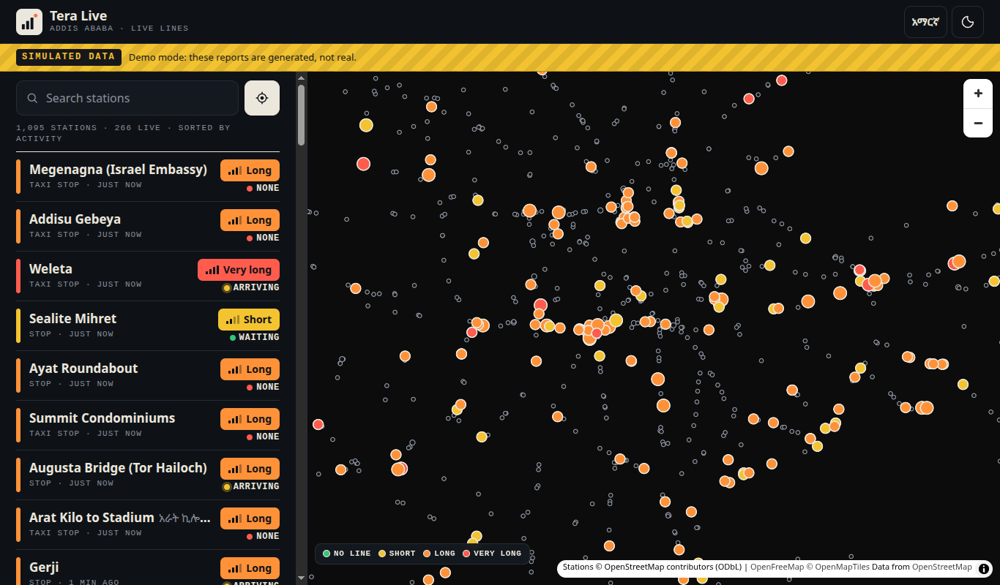
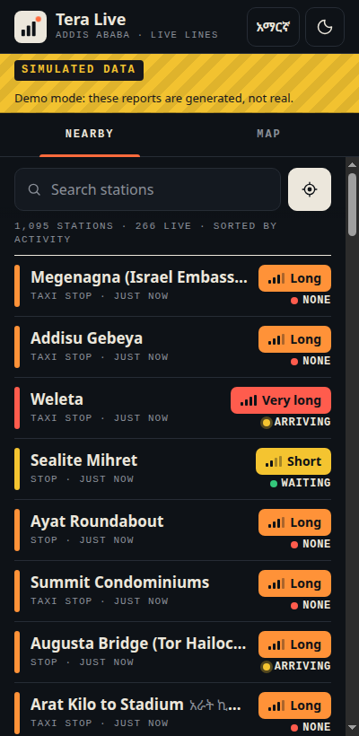

# Tera Live (ተራ)

**Live minibus queues for Addis Ababa, crowdsourced one tap at a time.**

[](https://github.com/tofiqueadam/tera-live/actions/workflows/ci.yml)


**▶ [Try the live demo](https://tofiqueadam.github.io/tera-live/?demo=1)** (simulated data, clearly badged) · [Replay the 8 a.m. rush](https://tofiqueadam.github.io/tera-live/?demo=1&hour=8)

Every morning, thousands of people in Addis walk to a *tera* (minibus station) without knowing whether the line is five people or two hundred. Tera Live answers that question. People at the station report what they see in two taps, from the web app or a Telegram bot. Everyone nearby then gets a live board. The board also shows what the queue is *usually* like at that hour.



> The screenshots use **demo mode**, which is clearly badged *SIMULATED DATA*. The app never presents generated reports as real.

## Features

- **1,095 real stations** from OpenStreetMap, built by a reproducible pipeline.
- **Two-tap reporting:** pick the queue length (none / short / long / very long) and whether minibuses are waiting.
- **Telegram bot** for one-handed reporting through inline buttons. Every callback is validated, and tampered button data is rejected.
- **"Usually at this hour"**, a hierarchical Bayesian estimate. Each level borrows strength from the level above: city → station → station × hour → station × weekday × hour. A single prank report can't redefine "usual".
- **Fresh data counts more.** Reports decay with a 20-minute half-life, so a queue from an hour ago barely counts.
- **Abuse resistance:** per-device and per-IP rate limits, duplicate detection, impossible-travel checks, station-hopping heuristics, and salted hashing (no raw IPs are stored).
- **Amharic and English** throughout, plus light and dark themes.
- **Installable PWA** with an offline app shell.
- **No sign-up.** Devices get an anonymous random ID.

<p align="center"></p>

## Architecture

```
 OpenStreetMap ──► scripts/fetch-stations.mjs ──► web/data/stations.geojson
                                              └─► worker/src/generated/stations.json

 Browser (PWA) ─┐
                ├──► Cloudflare Worker (TypeScript) ──► D1 (SQLite)
 Telegram bot ──┘        validate · rate-limit · abuse checks
                         live snapshot · hourly stats (cron)
```

| Part | Stack |
|---|---|
| `web/` | Vanilla JS modules (no build step), MapLibre GL on OpenFreeMap vector tiles, service worker |
| `worker/` | Cloudflare Worker + D1, tested with Vitest inside `workerd` |
| `scripts/` | Overpass API → GeoJSON pipeline (cached, deterministic output) |
| `web/js/core/` | Domain model and estimator, shared by the browser and the Worker |

### API

| Method | Path | Purpose |
|---|---|---|
| `GET` | `/api/live` | Current status of every active station |
| `GET` | `/api/stations/:id` | Live board and "usually at this hour" for one station |
| `POST` | `/api/reports` | Submit a report |
| `GET` | `/api/meta` | Status enums |
| `GET` | `/api/health` | Health check |
| `POST` | `/telegram/webhook` | Telegram bot updates |

## Run it locally

**Front-end only (demo mode):**

```bash
cd web && python3 -m http.server 8080
# open http://localhost:8080/?demo=1          simulated live data
# open http://localhost:8080/?demo=1&hour=8   replay the 8 a.m. rush
```

**Worker API:**

```bash
cd worker
npm ci
npm run db:migrate:local
npm run dev          # http://localhost:8787
npm test             # 73 tests against workerd + local D1
```

Then set `apiBase` in `web/config.js` to the Worker URL.

**Rebuild the station list:**

```bash
node scripts/fetch-stations.mjs --refresh
```

## Deploy

1. Create a D1 database: `npx wrangler d1 create tera-live`. Put its ID in `worker/wrangler.jsonc`.
2. Set the secrets: `HASH_SALT`, plus `TELEGRAM_BOT_TOKEN` and `TELEGRAM_WEBHOOK_SECRET` if you use the bot (`npx wrangler secret put …`).
3. Run `npm run db:migrate:remote && npm run deploy`.
4. Host `web/` on any static host (for example, Cloudflare Pages), and add its origin to `ALLOWED_ORIGINS`.

## Data and licence

Station data © OpenStreetMap contributors, licensed under the [ODbL](https://opendatacommons.org/licenses/odbl/). Map tiles come from [OpenFreeMap](https://openfreemap.org).

Code is under the MIT licence.
